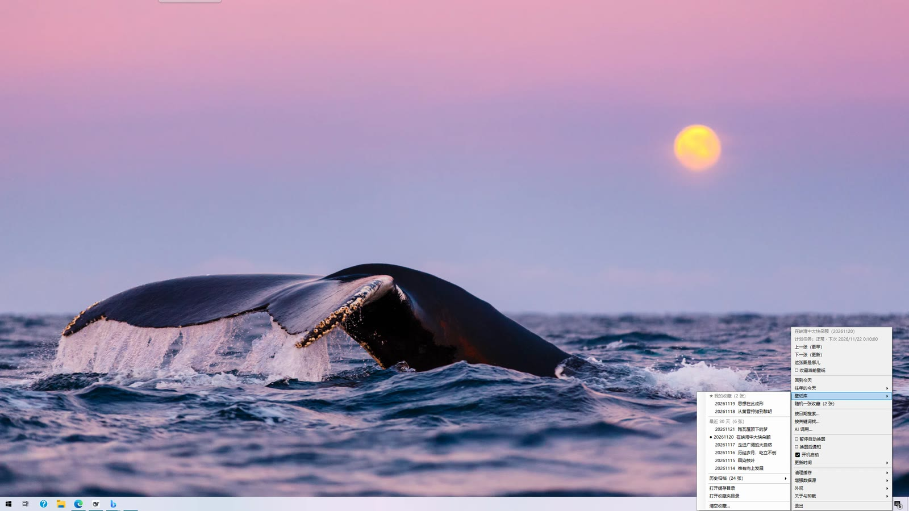

# BingWallpaperChronicle

*Also known in Chinese as 必年代记.*

[中文](README.md) | **English**

Every Bing China wallpaper from **July 2009** to today — **6341 days** of daily images.
Browse, search, or bulk-download. Since 2019 the originals are
**3840×2160 watermark-free** — Microsoft's own client ships 468 KB watermarked JPEGs.

| | |
|---|---|
| Version | 3.6.102 |
| Coverage | 2009-07-13 → today, **6341 days** |
| Gaps | **6 days** — per-day list and every source tried are in [MISSING.md](MISSING.md) |
| Quality | 4K 2670 · 1080p 1919 · 1366-tier 503 · 958×512-tier 1162 |
| Size | full set **11.15 GB** (6,341 images) |
| Runtime | none. .NET Framework 4.x (ships with Windows) + built-in PowerShell |
| Offline | the index is embedded in the exe — search and browse titles without network |




See [CHANGELOG.md](CHANGELOG.md) for version history and [docs/CLI.md](docs/CLI.md) for the command line reference.

> Repository name is `bing-wallpaper-chronicle`; the executable is still `BingWallpaperLite.exe` for continuity. Built with AI assistance — details under Notes.

## Why build another one

Microsoft's official client shows a promotional banner that can't be turned off. It's a separate child window; normal fixes don't work, and the only option is to force-hide it via a system call — after which the main program just recreates it on next launch.

Worse, **what appears there is decided remotely**. Today it's a close button; tomorrow it could be a campaign promo or something else entirely. I can't stop that — the code isn't mine.

Rolling back should work, right? Official channels only ship MSIX now; the double-clickable EXE was delisted long ago. Digging a 2021 build out of the Internet Archive gave something worse: 468 KB watermarked JPEGs.

Meanwhile the same Bing endpoint still serves a 3.5 MB watermark-free original.

So I wrote one: talk only to Bing's public endpoints, keep all behaviour in local code, no remote instructions of any kind.

## Quick start

Download `BingWallpaperChronicle-v3.6.102-Setup.exe` from [Releases](../../releases), double-click, pick a folder.

The installer backs up your current wallpaper to the desktop first. After installing it registers auto-start, registers a scheduled task (00:10 / 08:10 / 12:10 daily, plus at logon), and **immediately changes your desktop wallpaper**.

> ⚠️ Note the third one — your desktop changes right after install.

Portable use: same `Setup.exe`, choose "run portable" and it unpacks the script and icons into the current folder without touching the registry or creating a scheduled task.

Once it's running:

| Goal | How |
|---|---|
| Change the wallpaper | Right-click the tray icon → Previous / Next, or "Jump to today" |
| Find a specific day | "Search by date…" opens a calendar; "Find by keyword…" searches titles and copyright |
| Download a whole range | Library ▸ Batch download…, pick a date range and a target folder |
| Use your own image library | Takeover mode — see below |

## What it does

### Changing the wallpaper

* Switches to the day's image at 00:10, re-checks at 08:10 / 12:10 (Bing is sometimes late)
* **Browsing back is not limited to the 8-day API window** — it continues into the local index, all the way to July 2009
* Won't re-download the same image when today's hasn't been published yet (exit code 9)
* **Rotation** — switches the desktop every 5/10/15/30/60/120 minutes (or a custom 1–720); mutually exclusive with "pause auto-change"; picks only from images already on disk, never downloads
* Rotation waits until today's image is in place before starting its timer

### Finding images

* Calendar covering any day from **July 2009** to today
* **This day in past years** — one click shows the same date across a decade
* **Filter by festival** — Spring Festival, Lantern, Qingming, Dragon Boat, Mid-Autumn, Double Ninth, National Day, New Year, New Year's Eve. Dates are computed from the lunar calendar on the fly, so next year is already correct
* **Keyword search** — 6,341 local index entries matching title and copyright, ranked by hit count, works offline
* **Random sample** — with an empty keyword it draws 20 entries from the index; with results it picks one at random

### Managing the library

* Three tiers: favorites / last 30 days / previously used wallpapers
* Favorites use **move semantics** — the same image is never stored twice; unfavoriting moves it back to cache, title intact
* **Favorite manager** — multi-select and remove in bulk (files return to cache, not deleted), with 240×135 previews and copyright
* **Auto-clean protection** — records dates you browsed or picked so the 30-day cleanup skips them
* **Export links** — generate a 4K direct-link list for a date range, copy or save as txt for IDM / Aria2
* **Batch download** — pull a date range into any folder, multiple sources with failover, failure list on disk, resumable
* **Cleanup dialog** — shows totals, sizes and per-source retention before deleting; choose Recycle Bin or permanent

### Takeover mode (chronicle)

Point the app at an image library you collected yourself; the desktop then draws from that library instead of the daily cache.

* **Grow-only**: new images keep arriving, nothing already there is cleaned, moved or renamed
* Leaving deletes only the app's own sandbox (config, state, index) — your images are untouched
* Gallery mode and all cleanup commands are disabled while in takeover
* The window shows image count, day coverage and how many days are missing, with a fill button

### Reliability

* The scheduled task runs independently — **closing the tray icon doesn't stop the daily change**
* Scheduled task health is shown right in the menu; click to repair when it's off
* Corrupted cache files are detected and re-downloaded; failures retry every 15 minutes, up to 3 times
* If you set your own wallpaper manually, the app backs up the one it was managing to the desktop and tells you

## Menu map

Right-click (or left-click) the tray icon:

```
Current: Face Canyon (20261127)
Scheduled task: OK · next 2026/11/28 0:10:00
Previous (older)
Next (newer)
Where is this image
[ ] Favorite current
Favorite manager…
─────────────────────
Jump to today
This day in past years ▸
Library ▸
Random ▸              ← rotation toggle and interval at the end
─────────────────────
Search by date…
Find by keyword…
─────────────────────
[ ] Pause auto-change
[ ] Notify after change
[ ] Start with Windows
Update time  00:10
─────────────────────
Cleanup ▸   Mirror ▸   Appearance ▸   System ▸
─────────────────────
Exit
```

`Library ▸` ends with **Export downloaded wallpapers…** and **Batch download…**; the latter has a "links only" mode that turns the range into a direct-link list for an external downloader.

`System ▸` contains Help / About / **Command line (for AI)** / Open log / Uninstall.

## About image quality

Bing hasn't always served 4K. Four tiers, older means smaller — **none of this is a download failure**:

| Years | What's actually available | Count | Why |
|---|---|---|---|
| 2019 → today | 3840×2160 or larger | 2670 + 87 | Bing serves UHD |
| 2016-03 ~ 2018 | 1920×1080 (~350 KB) | 1919 | Bing only published 1080p then |
| 2013 ~ 2016-02 | 1366×768 | 503 | original uploads purged, mirrors only |
| 2009-07 ~ 2013 | 958×512 | 1162 | same, and the mirror only kept this tier |

Quality is always judged by **actual pixel width**, never file size — there are UHD files that compress to 2.34 MB, and the same URL has returned different sizes on different calls.

A few post-2019 dates still have no UHD (verified: 2023-01-16 and 2023-02-04 return 1080p from the `_UHD` endpoint). Those get recorded in `cache\no-uhd.json` and are not retried.

**Six days cannot be recovered**: the originals for `20091026`, `20101201`, `20121009` were deleted at Bing and the mirrors don't have them; `20100416`, `20100417`, `20120814` never appeared in Bing's index at all. See [MISSING.md](MISSING.md) for the per-day list and all nine sources tried.

## Command line

The core script runs standalone — for automation or for an AI assistant. **Full parameter table, exit codes and JSON samples are in [docs/CLI.md](docs/CLI.md)**; the most common calls:

```powershell
.\bing-wallpaper.ps1 -Index 0            # switch to today's (forced)
.\bing-wallpaper.ps1 -Date 20180315      # switch to a date
.\bing-wallpaper.ps1 -Step 1             # one step older, past the 8-day window
.\bing-wallpaper.ps1 -Query "cherry"     # search and list matches, no switch
.\bing-wallpaper.ps1 -Status -Json       # current state as JSON
```

Every parameter is **idempotent**: running the same command twice has no extra effect.

Exit codes:

| Code | Meaning |
|---|---|
| 0 | success |
| 1 | general error |
| 2 | another instance is running |
| 3 | cannot favorite (image not in cache) |
| 4 | at the boundary, nothing to switch to |
| 5 | no wallpaper for that date |
| 6 | index needs fetching first |
| 7 | index source unreachable |
| 8 | success but degraded quality |
| 9 | today's image not published yet |
| 11 | image in place, wallpaper did not apply (permissions / policy / locked file) |
| 12 | date out of range (future date) |

## FAQ

**"Pause auto-change" does not disable switching.** It only stops the daily automatic update; manual switching still works.

**Favoriting moves the file.** It goes from `cache\` to `favorites\`, so it disappears from "last 30 days" — it's under Favorites instead. Unfavoriting moves it back, title intact.

**`archive\images\` vs `cache\`.** The former holds originals fetched while browsing history or a specific date; the 30-day rule never touches it, only the 500 MB cap. The latter is the daily cache. When the cap is hit it deletes images outside your browse history first.

**Pre-2016 images are never auto-cleaned.** They live in `archive\old\<month>\`, outside the 500 MB cap; neither the 30-day rule nor the size-cap sweep touches them — re-downloading from a mirror costs far more than the 0.2 MB they occupy.

**Do I lose my images when leaving takeover mode?** No. Takeover only points the app at your folder; leaving deletes the app's sandbox, not your files.

**Keyword search doesn't segment words.** Searching "snow mountain" won't match a title that has them as separate words unless you search `snow mountain` in that order, or split manually.

## Development

### Layout

```
src\                    sources, compiled to BingWallpaperLite.exe   37 files / 15,514 lines
  Program.cs            entry + constants + config + bootstrap        1,331 lines
  Refresh.cs            refresh orchestration (three layers)          1,911 lines
  Strings.cs            S class, all UI strings (zh/en)               1,536 lines
  Menu.cs               menu construction and refresh                   632 lines
  MenuState.cs          menu availability decision table                256 lines
  Script.cs             script invocation and JSON parsing              407 lines
  Info.cs               "where is this image"                           392 lines
  Install.cs            install / uninstall / scheduled task / autostart 491 lines
  SelfUpdate.cs         update check and download                       187 lines
  Update.cs             version probing                                 159 lines
  Tray.cs               tray icon and clicks                            181 lines
  Utils.cs              small helpers                                    49 lines
  Forms\                25 form classes, largest PhotoWallForm 1,035 lines

bing-wallpaper.ps1      core script, runs standalone                  5,301 lines
build.ps1               build + packaging                               219 lines
test.ps1                regression suite (234 assertions)             2,323 lines
docs\CLI.md             full command line reference

cache\                  last 30 days (auto-cleaned, not in repo)
favorites\              favorites (not in repo)
archive\                history index and images (not in repo)
dist\                   build output (not in repo)
```

### Build

```powershell
.\build.ps1                       # build
.\build.ps1 -Version 3.7.0      # bump version and build
.\build.ps1 -Portable             # also produce a portable zip (no longer released)
```

Only needs `.NET Framework 4.x` (ships with Windows), no external dependency.

Output lands in `dist\`, but **the running program is the copy in the repo root**. Three steps to make a build take effect locally — skip one and the tray icon is gone:

```powershell
Get-Process BingWallpaperLite | Stop-Process -Force   # 1. stop (locked file breaks the copy)
Copy-Item dist\BingWallpaperLite.exe . -Force         # 2. replace
Start-Process .\BingWallpaperLite.exe                 # 3. relaunch
```

The scheduled task invokes the script directly, so skipping step 3 only affects the tray icon and menu — the 00:10 change still happens.

### Tests

```powershell
.\test.ps1              # full regression (builds first)
.\test.ps1 -SkipBuild   # skip the build, test only
```

**234 assertions**, about two minutes. Everything goes through the command line — no UI, no network. Run it after any change and you know whether something else broke.

`BingWallpaperLite.exe --MenuSelfTest` additionally runs the menu availability table (44 checks) and writes `%TEMP%\BingWallpaperLite.menugate.txt`.

## Credits

The history comes from these projects; without them this tool would only see the last 8 days:

* [Zhu-junwei/bing-wallpaper-archive](https://github.com/Zhu-junwei/bing-wallpaper-archive) — complete index since March 2016, with Chinese titles and copyright
* [niumoo/bing-wallpaper](https://github.com/niumoo/bing-wallpaper) — secondary source since 2021-02 (IDs only, no titles)
* [bing.wilii.cn](https://bing.wilii.cn) — **primary index source**, ships official date fields and Chinese titles so nothing has to be inferred from page order; its filename table since 2016-03 is also embedded as the last-resort image fallback
* [bingwallpaper.anerg.com](https://bingwallpaper.anerg.com) — mirror for 2009-07 ~ 2016-03, covers 2013–2015 where wilii has no images; only direct links are built at runtime, the index is pre-harvested into the exe
* [gh-proxy.com](https://gh-proxy.com/) — GitHub acceleration, the main path when raw is unreachable
* Microsoft Bing — the images themselves

## Notes

**On AI involvement.** The UI, the bulk of the script and all strings were written by AI, but the division of labour changed over two years.

Early on AI did volume work: writing two hundred zh/en string pairs, laying out WinForms in one pass. It is fast at that, and its mistakes are consistent — the code looks right and doesn't run right.

The work now is closer to auditing: walking 5,300 lines of script to find "sets a value but never checks it", comparing resolution wording across three places, digging out failures swallowed by `catch { }`. One round in 3.6.49 turned up 12 issues, at least 5 of them found this way.

What hasn't changed is acceptance: **anything AI writes must run on this machine before it counts**. Hence 234 assertions, a BOM pre-check before compiling, and a dedicated exit code for "image in place but wallpaper didn't change". Those aren't decorations — they're patches over the places AI gets wrong.

**Known limits**:

* Old images fall into four quality tiers (see above) — 4K isn't available before 2019, that's Bing's inventory, not a failure
* Six days are unrecoverable, see [MISSING.md](MISSING.md)
* Keyword search is literal matching, no word segmentation
* `-FillLibrary` (fill missing days into the takeover library) only works in takeover mode

## License

MIT
