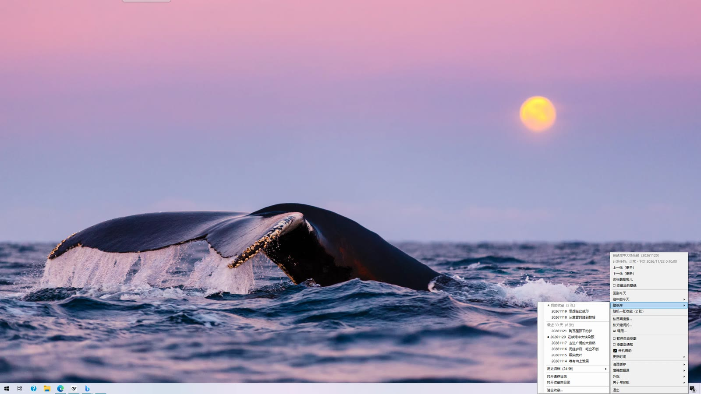

# 必应壁纸编年史

**又名「必年代记」** ｜ 必应中国区 2009-07-13 至今的每日壁纸档案

**中文** | [English](README.en.md)

必应中国区 **6341 天**的每日壁纸档案：可翻、可搜、可整墙下载，界面中英双语。
2019 年起是 **3840×2160 无水印原图** —— 微软官方客户端给的是 468 KB 的带水印压缩版。

| 项 | 数值 |
|---|---|
| 版本 | 3.6.102 |
| 覆盖 | 2009-07-13 → 今天，**6341 天** |
| 缺口 | **6 天**：[MISSING.md](MISSING.md) 里有逐日清单与已试过的全部来源 |
| 画质 | 4K 2670 张 · 1080p 1919 张 · 1366 档 503 张 · 958×512 档 1162 张 |
| 体积 | 全量 **11.15 GB**（6,341 张） |
| 依赖 | 无需运行时。.NET Framework 4.x（系统自带）+ 系统自带 PowerShell |
| 离线可用 | 索引内嵌进 exe，断网也能搜、能翻标题 |




版本变更见 [CHANGELOG.md](CHANGELOG.md)，命令行参考见 [docs/CLI.md](docs/CLI.md)。

> 项目名 `bing-wallpaper-chronicle`，可执行文件仍为 `BingWallpaperLite.exe`（沿用旧名，不影响功能）。本项目有 AI 参与，分工见文末「说明」。

## 为什么要自己写

官方客户端的推广浮层关不掉。那是个独立子窗口，常规改法无效，只能调系统接口硬藏；主程序一启动又重新建一次。

更麻烦的是，**那个位置显示什么是远端决定的**。今天是个关闭按钮，明天可能是活动推荐或者别的东西。我拦不住，因为代码不在我手里。

想着退回旧版本总行了吧——官方渠道只发 MSIX 包，能双击运行的旧 EXE 早下架了。从 Internet Archive 翻出 2021 年的装上，图还更差：468 KB 带水印的压缩版。

而同一个 Bing 接口明明留着一份 3.5 MB 的无水印原图。

所以自己写一个：只用 Bing 的公开接口取图，行为全在本地代码里，不做任何远端下发。

## 快速开始

从 [Releases](../../releases) 下载 `BingWallpaperChronicle-v3.6.102-Setup.exe`，双击，选个文件夹。

安装前会先把你当前的桌面壁纸备份一份到桌面。装完会：注册开机自启 → 注册计划任务（每天 00:10、08:10、12:10 + 登录时）→ **立即更换一次桌面壁纸**。

> ⚠️ 第三条需要提前知悉——装完桌面马上就变了。

想绿色使用：同一个 `Setup.exe`，双击后选「绿色运行」，会在当前文件夹展开脚本与图标，不写注册表、不建计划任务。

装完之后：

| 想做 | 怎么做 |
|---|---|
| 换一张 | 右键托盘图标 → 「上一张 / 下一张」，或「换到今天」 |
| 找一张 | 「按日期搜索…」翻日历，「按关键词找…」搜标题与版权 |
| 存一整套图 | 「壁纸库 ▸ 批量下载壁纸…」，指定日期范围下到任意目录 |
| 用一个自己的图库 | 「系统 ▸ 关于」旁边的接管入口，见下方「接管目录」 |

## 能做什么

### 换图

* 每天 00:10 自动换成当天的，08:10 / 12:10 各补查一次（Bing 偶有延迟）
* **前后翻页不受 8 天限制** —— 越过接口窗口后自动接续本地索引，可以一路翻到 2009 年 7 月
* 今天的新图没发布时不会重复下载同一张（退出码 9）
* **随机轮播** —— 按 5/10/15/30/60/120 分钟（或自定义 1–720）自动换桌面；和「暂停自动换图」互斥，只从本地已有的图里挑，不下载新图
* 轮播会等今天的图到位才开始计时：开机先补今天那张，然后再进轮播

### 找图

* 日历可选 **2009 年 7 月**至今的任意一天
* **往年的今天** —— 一键看过去十年同一天分别是哪张
* **按节日筛选** —— 春节 / 元宵 / 清明 / 端午 / 中秋 / 重阳 / 国庆 / 元旦 / 除夕，点开铺满历年照片墙。日期由农历算法现场算出，不维护数据表，明年自动就对
* **关键词搜索** —— 本地 6341 条索引，匹配标题与版权，按命中词数排序，不需要联网
* **随机抽一组** —— 关键词留空时从索引里随机抽 20 条任选，或对已有结果随机挑一张

### 管理图库

* 壁纸库分三段：收藏 / 最近 30 天 / 以前换过的壁纸
* 收藏为**移动语义**，同一张图不存两份；取消收藏会挪回缓存，标题不丢
* **收藏管理** —— 托盘菜单直入，勾选多张批量移出（文件退回缓存，不删除）；带 240×135 预览与版权
* **自动清理保留** —— 记录你翻过、选过的日期，30 天自动清理时跳过；窗口里能预览、批量加收藏、移出名单
* **导出下载链接** —— 指定日期范围生成 4K 直链清单，一键复制或存 txt，交给 IDM / Aria2
* **批量下载** —— 按日期范围直接下到指定目录，多源自动切换，失败清单落盘、断点续跑
* **清理前弹窗** —— 显示总数、体积、按来源分类的保留数量，可选「进回收站」或「彻底删除」

### 接管目录（编年史模式）

换一个图片仓库，只读挂载它 —— 你的桌面壁纸改成从自己收集的图里挑，而不是从缓存里挑。

* 接管中**只增不减**：新图照常下进来，已有的图一张都不会被清掉、移动或改名
* 退出时沙盒整体进回收站，可选先备份；原来的配置一点没动
* 接管中画廊模式自动禁用，清理类命令一律拒绝
* 窗口里能看「多少张图 / 覆盖多少天 / 缺几天」，缺的日期能一键补齐

### 可靠性

* 计划任务独立运行，**关掉托盘照常换图**
* 计划任务健康状况直接显示在菜单上，异常时可点击修复
* 缓存文件损坏会自动发现并重新下载；失败后每 15 分钟重试，最多 3 次
* 手动换过桌面壁纸时，程式会把原先管理的那张备份到桌面并提示

## 界面导览

右键（或左键）托盘图标打开菜单：

```
当前：灰金交织的峡谷（20261127）
计划任务：正常 · 下次 2026/11/28 0:10:00
上一张（更早）
下一张（更新）
这张图是哪儿
☐ 收藏当前壁纸
收藏管理…
─────────────────────
换到今天
往年的今天 ▸
壁纸库 ▸
随机一张 ▸          ← 末段是轮播开关与间隔
─────────────────────
按日期搜索…
按关键词找…
─────────────────────
☐ 暂停自动换图
☐ 换图后通知
☐ 开机启动
更新时间  00:10
─────────────────────
清理缓存 ▸   镜像源 ▸   外观 ▸   系统 ▸
─────────────────────
退出
```

`壁纸库 ▸` 里最后两项是**导出已下载壁纸…** 与 **批量下载壁纸…**；后者窗口里还有「只导出链接」，把日期范围换成直链清单交外部下载器。

`系统 ▸` 里是：帮助 / 关于 / **命令行说明（给 AI 用）** / 打开日志 / 卸载。

## 画质是怎么回事

Bing 的每日图不是一直有 4K 的。按年份分四段，越往前越差，**不是下载出错**：

| 年份段 | 实际能拿到的 | 张数 | 原因 |
|---|---|---|---|
| 2019 至今 | 3840×2160 或更大 | 2670 + 87 | Bing 提供 UHD |
| 2016-03 ~ 2018 | 1920×1080（约 350 KB） | 1919 | 那年 Bing 只发到 1080p |
| 2013 ~ 2016-02 | 1366×768 | 503 | 原始上传已被清理，只剩镜像档 |
| 2009-07 ~ 2013 | 958×512 | 1162 | 同上，镜像站只存了这一档 |

判画质一律看**实际像素宽度**，不看文件大小 —— 实测有 UHD 只压到 2.34 MB 的，也有同一地址两次返回体积不同的。

个别日期即使 2019 年后也没有 UHD（实测 2023-01-16、2023-02-04 的 `_UHD` 地址返回的就是 1080p）。这种日期记进 `cache\no-uhd.json`，之后不再重复尝试。

**6 天补不回来**：`20091026`、`20101201`、`20121009` 的原图已从必应下架、镜像站也没存；`20100416`、`20100417`、`20120814` 连官方索引都没有这一天。逐日清单和试过的九个来源见 [MISSING.md](MISSING.md)。

## 命令行

核心脚本可独立调用，接自动化或给 AI 用都行。**完整参数表、退出码、JSON 输出示例见 [docs/CLI.md](docs/CLI.md)**，这里只列最常用的：

```powershell
.\bing-wallpaper.ps1 -Index 0            # 换今天的（强制）
.\bing-wallpaper.ps1 -Date 20180315      # 换指定日期
.\bing-wallpaper.ps1 -Step 1             # 往前一张（更早），可越过 8 天窗口
.\bing-wallpaper.ps1 -Query "樱花"        # 搜索并列出匹配项，不改图
.\bing-wallpaper.ps1 -Status -Json       # 查当前状态，JSON 输出
```

所有参数**幂等**：重复执行同一条命令不会产生副作用。

退出码：

| 码 | 含义 |
|---|---|
| 0 | 成功 |
| 1 | 一般错误 |
| 2 | 已有实例在运行 |
| 3 | 无法收藏（非缓存目录的图） |
| 4 | 已到边界，无可切换 |
| 5 | 该日期没有壁纸 |
| 6 | 需要先取索引 |
| 7 | 索引源连接失败 |
| 8 | 成功但降级为压缩版 |
| 9 | 今天的新图还没发布 |
| 11 | 图已就位，但桌面壁纸未生效（权限 / 策略 / 文件被占用） |
| 12 | 日期越界（选了未来日期） |

## 常见问题

**「暂停自动换图」不是禁止换图。** 它只停每天那次自动更新，手动点换图仍然有效。

**收藏会把文件挪走。** 从 `cache\` 移到 `favorites\`，所以在「最近 30 天」里找不着——它在「我的收藏」那段。取消收藏会挪回来，标题不丢。

**`archive\images\` 和 `cache\` 有什么区别。** 前者是翻历史/按日期取图时下的原图，不会被 30 天规则清掉，只受 500 MB 总量上限约束；后者是日常缓存。满了先删「换图记录」之外的，还不够才动清单内的。

**2016 年前的老图不受任何自动清理。** 它们单独放在 `archive\old\月份\`，不在 500 MB 额度内，30 天规则和超限清理都不会动它 —— 从镜像站重下的成本太高，而单张只有 0.2 MB，删了省不下空间。

**接管模式退出后，我的图还在吗。** 在。接管只是把软件指向你的目录，不搬文件；退出时删的只有软件自己的沙盒（配置、状态、索引）。

**关键词搜索不分词。** 「雪山」搜不到标题里写成「雪」「山」分开的，得手动拆成 `雪 山`。

## 开发

### 目录结构

```
src\                    源码，编译成 BingWallpaperLite.exe    37 个文件 / 15,514 行
  Program.cs            入口 + 常量 + 配置 + 自举              1,331 行
  Refresh.cs            刷新编排（三层）                       1,911 行
  Strings.cs            S 类，中英文案                         1,536 行
  Menu.cs               菜单构建与刷新                           632 行
  MenuState.cs          菜单可用性判定表                         256 行
  Script.cs             调用脚本与 JSON 解析                     407 行
  Info.cs               这张图是哪儿                             392 行
  Install.cs            安装 / 卸载 / 计划任务 / 自启            491 行
  SelfUpdate.cs         检查更新与下载                           187 行
  Update.cs             版本探测                                 159 行
  Tray.cs               托盘图标与点击                           181 行
  Utils.cs              小工具                                    49 行
  Forms\                25 个窗体类，最大 PhotoWallForm 1,035 行

bing-wallpaper.ps1      核心脚本，可独立运行                   5,301 行
build.ps1               编译 + 打包                              219 行
test.ps1                回归测试（234 项断言）                 2,323 行
docs\CLI.md             命令行完整参考

cache\                  最近 30 天缓存（自动清理，不入库）
favorites\              收藏（不入库）
archive\                历史索引与图片（不入库）
dist\                   发布产物（不入库）
```

### 编译

```powershell
.\build.ps1                       # 编译
.\build.ps1 -Version 3.7.0      # 改版本号并编译
.\build.ps1 -Portable             # 顺带打绿色版 zip（已不发 Release，仅本地备用）
```

只需要 `.NET Framework 4.x`（Windows 自带），无外部依赖。

编译产出在 `dist\`，但**程序实际运行的是根目录那份**。让新版本在本机生效是三步，少一步托盘就没了：

```powershell
Get-Process BingWallpaperLite | Stop-Process -Force   # 1. 停（文件被占用时复制会失败）
Copy-Item dist\BingWallpaperLite.exe . -Force         # 2. 换
Start-Process .\BingWallpaperLite.exe                 # 3. 拉起来
```

计划任务独立调脚本，所以漏掉第 3 步只影响托盘图标与右键菜单，不影响 00:10 的自动换图。

### 测试

```powershell
.\test.ps1              # 跑完整回归（含编译）
.\test.ps1 -SkipBuild   # 跳过编译，只测功能
```

**234 项断言**，约 2 分钟。全部走命令行，不碰界面，不依赖网络。改完功能跑一遍，就知道有没有破坏别的。

另外 `BingWallpaperLite.exe --MenuSelfTest` 会跑菜单可用性判定表（44 项），结果写 `%TEMP%\BingWallpaperLite.menugate.txt`。

## 鸣谢

历史数据来自这些项目，没有它们这个工具只能看最近 8 天：

* [Zhu-junwei/bing-wallpaper-archive](https://github.com/Zhu-junwei/bing-wallpaper-archive) —— 2016 年 3 月至今的完整索引，含中文标题与版权
* [niumoo/bing-wallpaper](https://github.com/niumoo/bing-wallpaper) —— 同域备用源（2021-02 起，只有 ID，无标题）
* [bing.wilii.cn](https://bing.wilii.cn) —— **主索引来源**，带官方日期字段与中文标题，不需要靠页面顺序反推；2016-03 起的文件名表也作为**取图末端兜底**打进 exe
* [bingwallpaper.anerg.com](https://bingwallpaper.anerg.com) —— 老图镜像（2009-07 ~ 2016-03），2013–2015 段的图片由它提供；运行时只拼图片直链，索引已离线抓好打进 exe
* [gh-proxy.com](https://gh-proxy.com/) —— GitHub 加速，国内直连 raw 走不通时的主通道
* Microsoft Bing —— 图片本身

## 说明

**关于 AI 参与**。界面、脚本主体、中英文案都是 AI 写的，但分工在这两年变过。

早期 AI 干的是铺量：把两百多条中英文案成对写出来、把 WinForms 布局一次写全。这类活它确实快，但错法很一致 —— 代码看着对，跑起来不对。

现在的活更接近审计：翻 5,300 行脚本找「设置了但不检查返回值」，比对三处文案的分辨率口径是否一致，把 `catch { }` 里吞掉的失败一条条挖出来。3.6.49 那轮翻出 12 个问题，至少 5 个是这么找到的。

不变的是验收方式：**AI 写的东西必须在本机跑过才算数**。所以有 234 项断言、有编译前的 BOM 预检、有「图就位但桌面没换上」这种专门的失败码。这些不是给人看的门面，是 AI 容易错的地方一条条补出来的。

**已知限制**：

* 老图分辨率分四档，见上面「画质是怎么回事」——2019 年前拿不到 4K，这是 Bing 的库存决定的
* 6 天补不回来，见 [MISSING.md](MISSING.md)
* 关键词搜索是字面匹配，不做分词
* `-FillLibrary`（把缺失日期补进接管图库）只在接管模式下可用

## 许可

MIT
