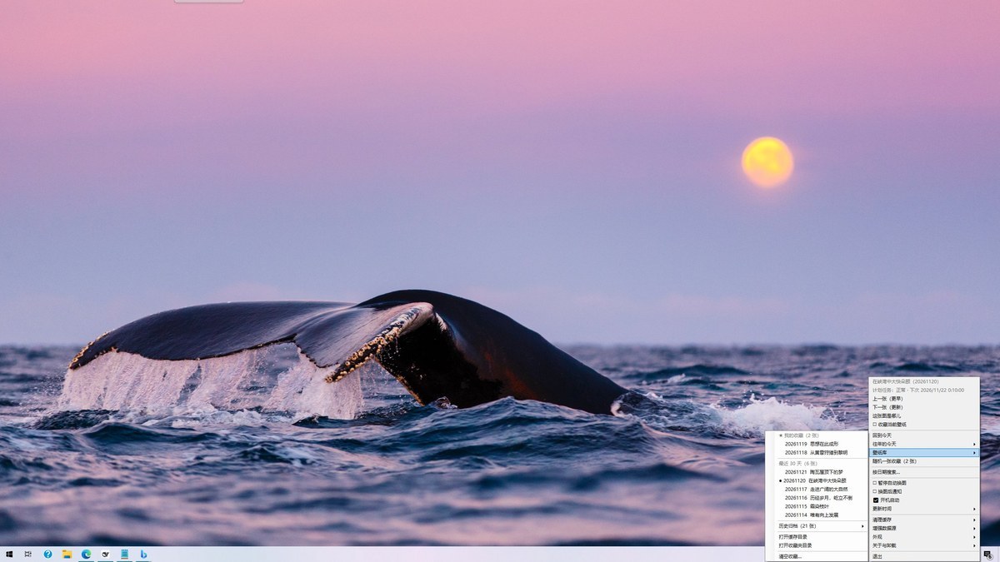

# 必应壁纸编年史

**中文** | [English](README.en.md)

Windows 上的必应每日壁纸工具。托盘 + 脚本 + 计划任务三层，历史可回溯到 **2016 年 3 月**，中英双语自适应。



版本变更见 [CHANGELOG.md](CHANGELOG.md)。

> 项目名 `bing-wallpaper-chronicle`，可执行文件仍为 `BingWallpaperLite.exe`（沿用旧名，不影响功能）。本项目有 AI 参与，分工见文末「说明」。

## 为什么要自己写

官方客户端的推广浮层关不掉。那是个独立子窗口，常规改法无效，只能调系统接口硬藏；主程序一启动又重新建一次。

更麻烦的是，**那个位置显示什么是远端决定的**。今天是个关闭按钮，明天可能是活动推荐或者别的东西。我拦不住，因为代码不在我手里。

想着退回旧版本总行了吧——官方渠道只发 MSIX 包，能双击运行的旧 EXE 早下架了。从 Internet Archive 翻出 2021 年的装上，图还更差：468 KB 带水印的压缩版。

而同一个 Bing 接口明明留着一份 3.5 MB 的无水印原图。

所以自己写一个：只用 Bing 的公开接口取图，行为全在本地代码里，不做任何远端下发。

## 特性

**换图**

* 每天 00:10 自动换成当天的，08:10 / 12:10 / 18:10 各补查一次（Bing 偶有延迟）
* **前后翻页不受 8 天限制** —— 越过接口窗口后自动接续归档索引，可以一路翻到 2016 年
* 今天的新图没发布时不会重复下载同一张（退出码 9）

**历史**

* 日历可选 **2016 年 3 月**至今的任意一天
* **往年的今天** —— 一键看过去十年同一天分别是哪张
* 历史图自动进 `archive\images\`，与日常缓存分开，不会被日常清理扫掉
* **归档总量上限 500 MB**（可改），超了按日期从旧到新删，但收藏的、清单保护的、当前在用的都不动

**找图**

* **关键词搜索** —— 本地 3915 条索引（2016-03 至今），匹配标题与版权，按命中词数排序
* 搜索覆盖全量历史，不需要等接口
* **AI 调用** —— 命令行接口可被任何 AI 助手驱动，`-Json` 返回结构化结果，`-Status` 查当前状态

**管理**

* 壁纸库分三段：收藏 / 最近 30 天 / 历史归档
* 随机一张 —— 从收藏里挑，自动避开当前这张
* 收藏为移动语义，同一张图不存两份
* **清理前弹窗** —— 显示总数、体积、受保护数量，可选「进回收站」或「彻底删除」
* **清空收藏** —— 二次确认，当前壁纸若是收藏会自动移回缓存
* 暂停自动换图（只停自动的，手动照常）
* 深色浅色跟随系统，也可手动指定
* 界面中英双语，按系统语言自动切换

**可靠性**

* 计划任务独立运行，**关掉托盘照常换图**
* 计划任务健康状况直接显示在菜单上，异常时可点击修复
* 缓存文件损坏会自动发现并重新下载
* 失败后每 15 分钟重试，最多 3 次
* 手动换过桌面壁纸时，程式会把原先管理的那张备份到桌面并提示

## 安装

从 [Releases](../../releases) 下载 `Setup.exe`，双击，选个文件夹。

安装后会：

1. 注册开机自启
2. 注册计划任务（每天 00:10、08:10、12:10、18:10 + 登录时）
3. **立即更换一次桌面壁纸**

> ⚠️ 第三条需要提前知悉——装完桌面马上就变了。

也提供绿色版，解压到任意可写目录双击运行即可，不写注册表、不建计划任务。

## 使用

右键（或左键）托盘图标打开菜单：

```
当前：陶瓦屋顶下的梦（20261121）
计划任务：正常 · 下次 2026/11/22 0:10:00
上一张（更早）
下一张（更新）
这张图是哪儿
☐ 收藏当前壁纸
─────────────────────
回到今天
往年的今天 ▸
壁纸库 ▸
随机一张收藏
─────────────────────
按日期搜索…
按关键词找…
AI 调用…
─────────────────────
☐ 暂停自动换图
☐ 换图后通知
☐ 开机启动
更新时间  00:10
─────────────────────
清理缓存 ▸   增强数据源 ▸   外观 ▸   关于与卸载 ▸
─────────────────────
退出
```

`壁纸库 ▸` 里最后一项是 **清空收藏…**，会先弹窗显示数量和体积再让你选删除方式。

### 几个容易搞混的地方

**「暂停自动换图」不是禁止换图**。它只停每天那次自动更新，手动点换图仍然有效。

**收藏会把文件挪走**。从 `cache\` 移到 `favorites\`，所以在「最近 30 天」里就找不着了——它在「我的收藏」那段。取消收藏会挪回来，标题不丢。

**`archive\images\` 是什么**。翻历史/按日期取图时下载的原图，和日常缓存的区别是不会被 30 天规则清掉，只受 500 MB 总量上限约束。

**2019 年 5 月前的图偏小**。那之前的原始上传已被 Bing 清理，只能拿到 1080p 的归档直链（约 350 KB）；之后的是原图，普遍 3–8 MB。

## 命令行

核心脚本可独立调用，接自动化或给 AI 用都行：

```powershell
.\bing-wallpaper.ps1                    # 换当天的（遵守暂停开关）
.\bing-wallpaper.ps1 -Index 0           # 强制换今天的
.\bing-wallpaper.ps1 -Step -1           # 往前一张（更新的）
.\bing-wallpaper.ps1 -Step 1            # 往后一张（更早的），可越过 8 天窗口
.\bing-wallpaper.ps1 -Date 20180315     # 指定日期
.\bing-wallpaper.ps1 -Use "D:\x.jpg"    # 指定本地文件
.\bing-wallpaper.ps1 -Random            # 从收藏随机
.\bing-wallpaper.ps1 -Favorite          # 收藏当前壁纸
.\bing-wallpaper.ps1 -Unfavorite        # 取消收藏（移回缓存，标题保留）

.\bing-wallpaper.ps1 -Query "樱花"       # 搜索并列出匹配项（不改图）
.\bing-wallpaper.ps1 -KwFile "kw.txt"   # 同上，关键词从 UTF-8 文件读（PS 5.1 传中文更稳）
.\bing-wallpaper.ps1 -Search "樱花"      # 搜索并换第一张匹配的

.\bing-wallpaper.ps1 -Status            # 查当前状态
.\bing-wallpaper.ps1 -Status -Json      # 同上，JSON 输出
.\bing-wallpaper.ps1 -Date 20230615 -Json   # 换图并返回结构化结果

.\bing-wallpaper.ps1 -Clean -Keep 7     # 清理 7 天前的缓存
.\bing-wallpaper.ps1 -CleanAll          # 清空缓存（保留当前壁纸）
.\bing-wallpaper.ps1 -CleanArchive      # 清理历史归档（保护收藏/清单/当前）
.\bing-wallpaper.ps1 -CleanArchiveIndex # 清理归档索引 json
.\bing-wallpaper.ps1 -CleanFavorites    # 清空收藏（当前壁纸移回缓存）
.\bing-wallpaper.ps1 -CleanMode permanent   # 配合上面三个，彻底删除而非进回收站
```

所有参数**幂等**：重复执行同一条命令不会产生副作用。

退出码：

| 码 | 含义 |
|---|---|
| 0 | 成功 |
| 1 | 一般错误 |
| 2 | 已有实例在运行 |
| 3 | 无法收藏（非缓存目录的图） |
| 4 | 已到边界，无可切换 |
| 5 | 该日期没有壁纸 |
| 6 | 需要开启增强数据源 |
| 7 | 归档源连接失败 |
| 8 | 成功但降级为压缩版 |
| 9 | 今天的新图还没发布 |

## 鸣谢

历史数据来自这些项目，没有它们这个工具只能看最近 8 天：

* [Zhu-junwei/bing-wallpaper-archive](https://github.com/Zhu-junwei/bing-wallpaper-archive) —— 2016 年 3 月至今的完整归档，含中文标题与版权
* [niumoo/bing-wallpaper](https://github.com/niumoo/bing-wallpaper) —— 备用源
* [gh-proxy.com](https://gh-proxy.com/) —— GitHub 加速，国内直连 raw 走不通时的主通道
* Microsoft Bing —— 图片本身

## 开发

### 目录结构

```
src\                    源码，编译成 BingWallpaperLite.exe
  Program.cs            文件头 + 常量 + 配置读写 + 自举 + 入口     586 行
  Strings.cs            S 类，中英文案                            411 行
  Menu.cs               菜单构建与刷新                            423 行
  Tray.cs               托盘图标与点击                            172 行
  Refresh.cs            刷新编排（三层）                          723 行
  Script.cs             调用脚本与 JSON 解析                      234 行
  Info.cs               这张图是哪儿                              264 行
  Install.cs            安装/卸载/计划任务/自启                    440 行
  Utils.cs              小工具                                     54 行
  Forms\                8 个窗体类，各 37-219 行

bing-wallpaper.ps1      核心脚本，可独立运行                      1783 行
build.ps1               编译 + 打包
test.ps1                回归测试（16 项断言）

cache\                  最近 30 天缓存（自动清理，不入库）
favorites\              收藏（不入库）
archive\                历史索引与图片（不入库）
dist\                   发布产物（不入库）
```

### 编译

```powershell
.\build.ps1                       # 编译
.\build.ps1 -Version 3.3.0        # 改版本号并编译
.\build.ps1 -Portable             # 顺带打绿色版 zip
```

只需要 `.NET Framework 4.x`（Windows 自带），无外部依赖。

`build.ps1` 优先编译 `src\` 下所有 `.cs`；如果 `src\` 不存在，退回编译单文件 `TrayProgram.cs`。

### 测试

```powershell
.\test.ps1              # 跑完整回归（含编译）
.\test.ps1 -SkipBuild   # 跳过编译，只测功能
```

16 项断言，约 20 秒。全部走命令行，不碰界面，不依赖网络。

改完功能跑一遍，就知道有没有破坏别的。

## 说明

**关于 AI 参与**。这个项目从界面到脚本都有 AI 辅助。AI 擅长的是一次性铺量：把 200 多条中英文案成对写出来、把 WinForms 布局代码一次写全。不擅长的是两件事——

一是**环境细节**。比如 `schtasks` 的中文输出编码，AI 默认按 UTF-8 处理，实际得按系统 OEM 代码页读，这个坑踩了三次。

二是**运行时行为**。比如给 `ToolStripMenuItem` 加悬停预览，代码看着完全正确，实际每次悬停都会重绘两次。这类问题只有跑起来才知道，AI 写的时候不知道。

所以界面和脚本主体是 AI 写的，但每个功能都要在本机跑过才算数。

**已知限制**：

* 归档只有 2016-03 至今，更早的 Bing 自己也清理了
* 关键词搜索是字面匹配，不做分词。"雪山"搜不到"雪"和"山"分开写的标题，得手动拆成 `雪 山`
* 2019-05 前的图分辨率偏低

## 许可

MIT
